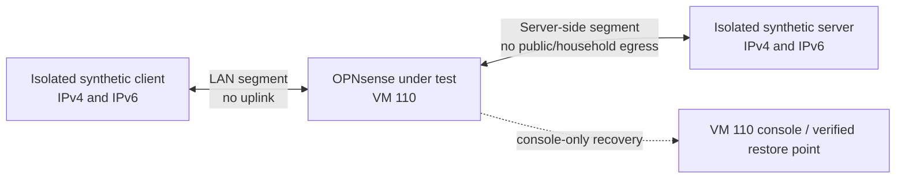

# Isolated packet lab design

**Task:** [M00-W03-T01](../tasks/m00/M00-W03-T01.md) · [GitHub #7](https://github.com/JoseLArantes/detew/issues/7)\
**State:** design proposal; historical console entry was reported, but isolation, offline authentication and recovery are unverified\
**Requirements:** INS-07, OPS-03, OPS-09, QLT-01/02; [PRD §5](../PRD.md#5-inspection-and-filtering-requirements), [§8](../PRD.md#8-opnsense-integration-and-operations), [§11](../PRD.md#11-quality-targets-and-workload-definition)\
**Product / architecture:** [packet path](../PRODUCT.md#51-packet-path), [G0 evaluation](../PRODUCT.md#91-g0-adapter-evaluation), [failure matrix](../PRODUCT.md#93-failure-matrix); ARC-04, ARC-14; ARCH-G01; [G0 proof](../ARCHITECTURE.md#63-required-g0-proof), [milestone evidence rules](../MILESTONES.md#52-evidence-artifacts-and-measurement-rules)

This document defines the required shape of a repeatable client/gateway/server lab and carries forward a previously recorded candidate environment. This revision is planning only: it uses synthetic addressing and tabletop analysis and does not authorize or perform live gateway, network, hypervisor, package, interface, or traffic operations. The observed-environment entries below are historical read-only notes and were not rechecked for this revision. T01 owns only the plan and tabletop review. T02 owns the VM-110-only recovery/isolation preflight and any separately authorized lab work. No packet attachment or generated traffic may occur until the hard preflight below passes, a qualified independent reviewer signs off, and the specific operation is authorized.

## Safety boundary

- The only permitted Proxmox scope is the configuration and console of VM 110. Do not change the Proxmox host, host bridges, storage, firewall, permissions, or any other VM. Do not create a host bridge as a shortcut.
- For this planning task, do not access or mutate VM 110, the Proxmox host, any live network, or any gateway. The VM-110-only boundary describes a future separately authorized lab operation; it does not authorize one now.
- OPNsense VM 110 is the only guest in scope. Treat its current interfaces as connected to the household network until the owner independently confirms otherwise.
- Never generate benchmark or denial traffic on the household network. The current guest interfaces are not client/server lab segments.
- Before any packet-adapter or interface mutation, require a VM 110 console session verified while guest networking is unavailable, a restorable VM 110-only snapshot or equivalent verified restore point, and a written teardown procedure. Console access to the running guest menu is available, but these recovery prerequisites have not been tested.
- Before any generated test traffic or Detew adapter attachment, verify offline console authentication, recovery to a known baseline, teardown, and structural IPv4/IPv6 no-uplink isolation in the authorized isolated state. A baseline restore/teardown demonstration does not prove a Detew-specific adapter detach action. If proving that action requires attaching the adapter, keep T02 blocked; no sequencing exception or adapter attachment is authorized by this plan.
- Test traffic and names must be synthetic. Capture only the generated flow, use lab addresses, and review/redact captures before retaining or sharing them. No household browsing, credentials, appliance configuration backups, or unrelated payloads belong in evidence.
- If isolation or recovery cannot be proved, stop before attachment or route changes. Retain the failure as a lab blocker; do not substitute a firewall rule on a live uplink for physical/virtual network isolation.

## Observed candidate guest

The following is the reported read-only inspection baseline; it is not a supported target or a validated lab:

| Field | Observed |
|---|---|
| Proxmox scope | VM 110 only for any future separately authorized lab operation; no host or other-VM changes permitted |
| Guest | OPNsense `26.1.2_5-amd64`, FreeBSD `14.3-RELEASE-p8` |
| Guest CPU | QEMU virtual CPU, 1 core / 1 thread |
| Guest interfaces | LAN and WAN are both attached to the same household IPv4 `/24`; exact addresses are omitted |
| Gateway/routing | Household default route reported; exact addresses and route details are omitted |
| Current addressing risk | The guest interfaces share a household subnet; this is not an isolated test topology |
| Guest management | HTTP web administration was reachable; HTTPS and SSH were not reachable during the inspection |
| Recovery access | A prior read-only report says the Proxmox UI opened the VM 110 console and displayed the OPNsense menu. Authentication with guest networking disabled, snapshot restore, and detach recovery are not verified; this was not rechecked in this revision. |
| Project target | OPNsense CE 26.7 series / FreeBSD 15.1 amd64, as documented in ARCHITECTURE; current guest differs |

Do not infer that an interface address or “WAN” label proves its actual upstream isolation. These observations are not an authorization to disconnect or readdress either interface.

## Required target topology

The target uses two isolated layer-2 segments and three roles. The only router under test is OPNsense in VM 110. Client and server endpoints must be synthetic and must not be production clients. Both segments must terminate inside a verified isolated environment with no path to the household uplink or public Internet. They must not be implemented by adding a Proxmox host bridge.

No such client/server path is currently verified. Before provisioning, the operator must identify a permitted way to supply both isolated segments using VM 110 only. Acceptable candidates require explicit inspection and proof before use:

1. A pre-existing isolated virtual network, if one exists, with VM-110-only virtual NIC changes and separately available synthetic endpoints. Its bridge must already have no physical uplink; do not create or modify Proxmox host networking.
2. A guest-local virtual topology inside OPNsense, only if its VNET/epair or equivalent interfaces are supported by the exact guest build and selected packet adapter. Before using it for packet tests, VM 110's external vNICs must be disconnected at the VM boundary or another independent upstream barrier must prove no egress; guest pf/route rules alone are insufficient. First verify the independent console, then prove the guest-local topology exercises the relevant firewall and adapter path. Treat it as a virtual candidate, not evidence for a physical NIC or general support.

If neither candidate can meet the isolation boundary, the lab is not provisionable under the current scope. Record the missing isolated path and request a revised authorized environment; do not attach the test to the existing home subnet.

### Address and route plan

These are reserved test-only examples, not configured addresses. Confirm they do not overlap with the actual lab endpoint routes before use.

| Segment | IPv4 | IPv6 ULA | Roles |
|---|---|---|---|
| Isolated LAN | `198.18.0.0/24` | `fd42:6465:7465:7701::/64` | Client `.2` / `::2`; gateway `.1` / `::1` |
| Isolated server side | `198.19.0.0/24` | `fd42:6465:7465:7702::/64` | Gateway `.1` / `::1`; server `.2` / `::2` |

Use specific routes so each endpoint can reach the opposite lab prefix without a default route:

| Endpoint | Required address | Specific route | Forbidden route |
|---|---|---|---|
| Client | `198.18.0.2/24`, `fd42:6465:7465:7701::2/64` | `198.19.0.0/24` via `198.18.0.1`; `fd42:6465:7465:7702::/64` via `fd42:6465:7465:7701::1` | No IPv4 or IPv6 default route |
| OPNsense LAN side | `198.18.0.1/24`, `fd42:6465:7465:7701::1/64` | Connected route to the LAN prefix | No route/default gateway to a household or public uplink |
| OPNsense server side | `198.19.0.1/24`, `fd42:6465:7465:7702::1/64` | Connected route to the server-side prefix | No route/default gateway to a household or public uplink |
| Server | `198.19.0.2/24`, `fd42:6465:7465:7702::2/64` | `198.18.0.0/24` via `198.19.0.1`; `fd42:6465:7465:7701::/64` via `fd42:6465:7465:7702::1` | No IPv4 or IPv6 default route |

The IPv4 fixture is inside the benchmarking-use range and the IPv6 fixture is a synthetic ULA example; both are examples only and must be checked against the isolated lab's actual routes before use. Do not advertise a default route from either endpoint. The base test has no NAT and no external interface connected to either lab segment. During any future authorized packet test, all lab vNICs must terminate on verified internal-only segments with no physical uplink, and every external VM vNIC must be disconnected or bounded by an independently verified no-egress barrier. Guest `pf` rules and missing routes are defense in depth, not the isolation boundary. Do not send probes to household or public addresses; prove the absence of an uplink from the topology and route graph, and use only synthetic endpoints/sinks inside the isolated lab. If a test requires NAT, enable only an explicitly listed translation between the isolated segments, record the pre-NAT and post-NAT tuples, and prove which original-client stage the adapter observes. Any DNS fixture uses a local synthetic resolver or fixed test addresses; no public resolver is required.

### VLAN, NAT, and unsupported variants

The base topology is untagged routed IPv4/IPv6. Add separate variants only after the base is recovered and repeatable:

| Variant | Fixture | Evidence to record |
|---|---|---|
| VLAN | Tagged client/server fixture VLANs (proposed IDs 101 and 102) carried only by the isolated virtual link | Tag presence at client, gateway ingress/egress and server; filtering order; any dropped/untagged frame behavior |
| NAT | Translation between the isolated LAN and isolated server-side segments | Original client before translation, translated address/port, reply path, connection state and packet captures at both endpoints |
| IPv6 | Routed ULA on both isolated segments, with explicit IPv6 policy | Neighbor discovery, both traffic directions, firewall allow/deny, and no dependence on IPv4 NAT |
| Long-lived | TCP established before a policy/adapter action, plus sustained TCP and UDP flows | Direction, flow age, continuity/termination, counters and client/server delivery |
| Virtual NIC candidates | Exact guest-visible NIC model and driver; candidate is not presumed supported | Link/MTU/offload/queue settings, capture ownership, bidirectional visibility, reinjection and failure behavior |
| Unsupported until measured | Physical NICs, hardware VLAN offload combinations, multiple WANs, bridges to any production LAN, public egress, and any unlisted topology | Mark unsupported/unmeasured; do not generalize a virtual test result |

### Candidate NICs and version identity

These are candidates for later evaluation, not a selected or supported adapter matrix. QEMU documents `virtio-net-pci` and `e1000` as virtual network-device models; FreeBSD documents the `vtnet(4)` VirtIO Ethernet driver and `em(4)`/`igb(4)` adapter families. Those references identify candidate model/driver families only; they do not prove the selected OPNsense build, Proxmox configuration, packet adapter, or failure behavior supports them. [QEMU network emulation](https://www.qemu.org/docs/master/system/devices/net.html), [FreeBSD 15.1-RELEASE `vtnet(4)`](https://man.freebsd.org/cgi/man.cgi?apropos=0&manpath=FreeBSD+15.1-RELEASE+and+Ports&query=vtnet&sektion=4), [FreeBSD 15.1-STABLE `em(4)`](https://man.freebsd.org/cgi/man.cgi?apropos=0&manpath=FreeBSD+15.1-STABLE&query=em&sektion=4), [FreeBSD 15.1-STABLE `igb(4)`](https://man.freebsd.org/cgi/man.cgi?manpath=FreeBSD+15.1-STABLE&query=igb&sektion=4).

| Candidate class | Proposed role | Required identity before a test | Current status |
|---|---|---|---|
| QEMU/KVM `virtio-net-pci` / guest `vtnet` | Primary virtual-NIC candidate | Exact QEMU/Proxmox model string, guest driver/revision, PCI vendor/device IDs, queues, offloads, MTU, link mapping | Candidate only; VM 110's actual vNIC model/driver was not captured in the carried-forward notes |
| QEMU/KVM `e1000` / expected guest `em` | Virtual compatibility comparison | Exact emulated model, guest driver/revision, PCI IDs, queues, offloads, MTU, link mapping | Candidate only; not selected and not assumed compatible with packet capture |
| Physical PCIe NIC using a target-FreeBSD `em`/`igb`-family driver | Future physical comparison, only if approved hardware is available | Vendor/device/subsystem IDs, board model/revision, firmware, exact driver/kernel, offloads, queues, link speed and MTU | No physical model selected or verified; physical support remains unclaimed |

Record exact software/hardware inputs for every run, not just a product family: Proxmox VE release/build and QEMU/KVM package versions; VM machine type/firmware/CPU/RAM; OPNsense image and package revisions; FreeBSD base/kernel revision; each vNIC model, guest interface/driver, PCI IDs, firmware, queue/offload settings and MTU; adapter and native-library revisions; compiler/toolchain; traffic/capture tools; pf/NAT/VLAN configuration; fixture digests; and Detew commit. Unknown fields remain `unverified`; do not infer them from the guest's interface label.

### Failure and unsupported-case matrix

| Condition | Required response | Evidence state until tested |
|---|---|---|
| Any lab segment has an unknown uplink or a path to household/public networks | Stop; do not generate packets or attach an adapter | Isolation failed/unverified; no lab run |
| Offline console authentication or VM-110-only restore path is unavailable | Stop before attachment or route/interface mutation | Recovery gate failed/unverified |
| A future separately authorized Detew attachment causes a blackhole or management loss | Use the reviewed console-only owned-detach action; if unavailable/fails, restore only the VM 110 checkpoint and verify guest state | No attachment or action is authorized until the detach/restore path is independently reviewed and proven |
| A competing capture consumer or unknown NIC owner is present | Refuse attachment; do not detach or reconfigure another consumer | Combination unsupported until reviewed |
| IPv4 works while IPv6 is absent, asymmetric, or reaches an external route | Disable the affected fixture; do not claim dual-stack coverage | IPv6 path unsupported/unverified |
| VLAN tags, NAT tuple/attribution stage, or return route differ from the fixture | Stop that variant and record the observed mismatch | Variant unsupported/unverified |
| Existing or long-lived flows are not visible in both directions | Mark that adapter/scope combination unsupported; do not infer bidirectional coverage | Flow-lifecycle evidence missing |
| Teardown leaves an unexplained VM-110 guest change or recovery fails | Quarantine the lab state; do not start another run; use only the verified VM-110 restore path | Lab remains blocked |

No failure case in this table has been induced or tested by this planning task.

## Provisioning and pre-traffic checklist

This is a future procedure for T02, not an authorization to run it. Record the owner, qualified independent reviewer, specific operation authorization, task reservation and intended restore point before beginning. Any missing or failed preflight item stops the run before generated traffic or Detew adapter attachment.

1. **Inventory without mutation.** Record VM 110 identity, guest release/kernel, configured virtual NIC models and mappings, topology, addresses, routes, DNS, pf state/rules and active client impact. Record Proxmox version and relevant VM-only hardware fields if access permits. Do not export or publish credentials, secrets or unredacted appliance configuration.
2. **Establish baseline recovery (REC-01).** Through the VM 110 console only, demonstrate local authentication with guest networking disabled; do not rely on the web UI, SSH, Detew or a remote client path. Record a VM-110-only restorable checkpoint and demonstrate recovery to the known baseline plus teardown in the isolated state. Tabletop a packet blackhole and failed remote administration; a reviewer must identify the console recovery and VM-110-only restore fallback without using Detew UI. This baseline demonstration does not prove Detew-specific adapter detachment.
3. **Verify structural isolation (ISO-4/ISO-6).** Inventory the exact LAN/server-side L2 segments and every physical/virtual uplink. Before generating any packets, the route/interface/configuration evidence must show no uplink, no endpoint/gateway default route, and no NAT/forwarding path to production/public networks for both IPv4 and IPv6. Guest `pf` is an additional control, not proof of isolation. Do not send probes to production or public addresses. If an uplink, route, address family, or attachment is uncertain, stop before traffic generation or adapter attachment.
4. **Pass the preflight stop gate.** A qualified independent FreeBSD/OPNsense reviewer must sign off on the topology, recovery and dual-stack isolation evidence, and the specific lab operation must be safely authorized. If any item fails or is missing, do not proceed. If Detew-specific detach/recovery can only be proved by attaching the adapter, keep T02 blocked and obtain a separate sequencing decision; this plan grants no exception or adapter authorization.
5. **Provision the base path only after preflight acceptance.** Under the separately recorded authorization, use only approved isolated endpoints and VM-110-only NIC settings or an independently proven guest-local alternative. Configure synthetic addresses, explicit routes, pf fixtures and sinks. Only now may T02 generate bypass traffic in isolated segments. No Detew adapter is attached for the bypass baseline.
6. **Record exact inputs.** Fill the run manifest below for every installed version and setting. Pin the exact OPNsense image/package revision, FreeBSD kernel, virtual NIC model/driver, VM CPU/RAM, firmware/machine type, MTU/offloads/queues, pf rules, adapter build if applicable, compiler, capture and generator tool versions, test fixtures and source digests. “Latest” or an unrecorded default is not an input identity.
7. **Measure the approved synthetic workload.** Verify an explicit pf deny by observing that the server receives no corresponding synthetic packet, while a permitted fixture succeeds. Confirm both directions and original-client address stage. Test existing/long-lived flows and capture-consumer conflicts only within the isolated approved topology.
8. **Teardown and restore.** Stop generators, preserve only approved synthetic evidence, remove test-owned guest endpoints/rules/routes/NAT/VLAN state, then compare the VM 110 guest configuration against the recorded pre-run inventory. If recovery is uncertain or the guest is unhealthy, restore only the VM 110 checkpoint through the verified console/operator path. Verify management and ordinary connectivity after restore; record any mismatch. Never restore or edit the Proxmox host as part of guest teardown.

REC-01 and both ISO checks must be observed and independently reviewed before any traffic or adapter attachment. Passing the baseline recovery demonstration does not establish Detew-specific detach behavior. The tabletop in this T01 document is planning analysis only and passes none of these gates.

## Traffic and bypass baseline method

The bypass run measures the candidate topology and normal forwarding path; it is not an inspection result or filtering claim. PRD §11.1 proposes an x86_64 reference appliance with four CPU cores, 8 GiB RAM, SSD storage, and two supported 1 GbE interfaces; this remains a workload proposal, not a selected or verified lab host. The carried-forward VM 110 notes show one QEMU vCPU and do not identify its NIC model, so those notes are not comparable to the proposed reference appliance. Select and publish the exact reference appliance, OPNsense release, adapter, topology and workload before benchmarking. Use the same exact host/configuration, pf fixture and endpoint workload for bypass and adapter runs.

PRD QLT-01 (at least 80% of same-appliance bypass goodput below saturation and p95 added RTT at most 5 ms) and QLT-02 (at least 20,000 active flows and 500 new flows/second) remain **unmeasured targets**, not results or a pass claim. The product/architecture budget candidates of 64 KiB per-flow reassembly, 32 provisional packets, and 1.5 seconds also remain **unmeasured** until a pinned build is tested. The workload values below are proposed input dimensions, not acceptance thresholds.

- Capture at the synthetic client, each guest-side gateway interface and synthetic server using bounded ring files. Use generated HTTP/TLS/UDP fixture traffic with no personal data. Record capture-drop counters and synchronize timestamps.
- The workload mix follows PRD §11.1: long transfers, short HTTP/TLS connections, supported QUIC, DNS, gaming/application fixtures, benign unknown traffic, and adversarial connection churn. Record each fixture as exercised, unavailable, or unsupported; the presence of a fixture does not imply that its content is visible to the gateway.
- Run TCP and UDP throughput, RTT/latency, packet loss and connection-establishment workloads. Include payload sizes 64, 512 and 1,400 bytes where supported; record exact tool arguments and the offered UDP rate. Include one-flow and multi-flow runs and both traffic directions.
- Proposed measurement tools for M00-W03-T02: `iperf3` for TCP/UDP goodput and loss, `ping` for round-trip samples, `tcpdump` for bounded captures at client/gateway/server points, and `vmstat`/`top` plus interface counters for CPU, memory and NIC behavior. These are uninstalled candidates in this plan; pin exact versions and confirm availability on isolated endpoints before the future run. Do not install tools or packages on a live gateway as part of this task.
- `curl` may generate HTTP/TLS fixtures and HTTP/3 only when the pinned endpoint build reports that feature; the future task must record its exact build and enabled protocols. The QLT-02 connection-churn tool is not selected here: M00-W03-T02 must choose and pin a generator that reports simultaneous active flows and new connections per second. Do not treat `iperf3` throughput as a substitute for that capacity measurement.
- Use at least five repetitions per fixed workload after the same warm-up period. Retain each result; report median, minimum/maximum and variability. Record CPU, memory, interface/driver counters and the exact runtime duration. Separate steady-state goodput from saturation/loss behavior.
- Run a permitted-flow fixture and an explicit pf-denied fixture. Expected: the permitted flow reaches the server and its reply reaches the client; the denied flow is absent at the server capture. A firewall log alone does not establish absence or delivery.
- Record the client address at client capture, gateway ingress, gateway egress and server capture. For NAT, preserve both original and translated tuple mappings. For each packet capture, record interface/direction and whether timestamps and checksum/offload handling affect interpretation.
- The report must state unmeasured hardware, traffic classes, interfaces and topology variants. A bypass number is a reference for this environment only, not a product capacity promise.

## Run manifest

Copy this table into each future `EV-M00-W03-T02` or adapter report and replace every blank with a value or explicit `unavailable`/`not applicable` reason.

| Input | Recorded value |
|---|---|
| Git commit / dirty-tree digest | |
| OPNsense image/release, installed package revisions, FreeBSD base/kernel build | |
| Proxmox VE release/build, QEMU/KVM package revisions; VM 110 firmware/machine type/vCPU model/count/RAM | |
| vNIC model string, guest driver/revision/interface, PCI IDs, link mapping, firmware, queues/offloads/MTU | |
| Lab segment IDs, isolation boundary, IPv4/IPv6 prefixes and routes | |
| VLAN IDs, NAT/pf fixture and rule digest | |
| Packet adapter/candidate build, native dependencies and compiler | |
| Traffic generator, RTT tool, capture/resource tools, versions and exact commands | |
| Fixture identities/licensing and SHA-256 digests | |
| MTU, duration, warm-up, repetitions and offered rate | |
| Capture points, direction, timestamps, drops and redactions | |
| Observed outcome, expected outcome, limits and anomalies | |
| Recovery checkpoint identity and console test evidence | |
| Reviewer, review date and teardown verification | |

Store private operational details outside public reports. Public reports may retain synthetic lab addresses and non-sensitive version/measurement identities, but must omit household addressing, credentials, session material, real client identifiers and unrelated payloads.

## Evidence checklist for an authorized future run

| Evidence item | Required record | Current status |
|---|---|---|
| Topology and egress isolation | VM-110-only device/segment map; IPv4/IPv6 no-uplink/interface/route evidence; no default route/NAT path to production; reviewer and exact configuration identity | Unverified; no current inspection or traffic test |
| REC-01 baseline recovery | Console authentication with guest networking disabled; VM-110-only restore point; demonstrated known-baseline restore and teardown; reviewer identifies the path without Detew UI | Unverified; no recovery or restore test demonstrated |
| Detew-specific detach | Exact owned-detach action and fallback restore proven independently of the UI | Unverified; if proof requires adapter attachment, T02 stays blocked pending a separate sequencing decision |
| Dual-stack path | Synthetic permitted and denied flows in both directions; endpoint and gateway captures; IPv4 and IPv6 interface/route/pf inputs | Unmeasured |
| Attribution, NAT and VLAN | Original and translated tuple stage; VLAN tag visibility; selected variant and explicit unsupported cases | Unmeasured |
| Capture ownership and failure | Consumer inventory/conflict result, flow lifecycle, engine/adapter failure and teardown/restore outcome | Unmeasured; no adapter attached |
| Workload and targets | Exact reference host/software/NIC/fixtures/tools, commands, repetitions, counters and comparison; QLT-01/02 status and limits | Unmeasured; tools/host not selected |
| Review and cleanup | Qualified independent technical reviewer, review disposition, redaction, test-owned teardown and VM-110-only state comparison | Pending; task remains open |

This checklist is a future evidence contract, not completed evidence. The current plan must not be cited as passing REC-01, ISO-4/ISO-6, ARCH-G01, QLT-01, or QLT-02.

## Current gate and next action

The carried-forward candidate notes say the guest's LAN and WAN are on the same household subnet; a separate dual-stack synthetic client/server path is not verified; console entry to the running guest menu was observed historically, while authentication with guest networking disabled and snapshot restore/detach recovery remain unverified; and its recorded OPNsense/FreeBSD versions differ from the architecture target. This revision performed no live inspection. The actual vNIC model/driver, Proxmox/QEMU version, route graph, and isolated endpoint inventory remain unverified. No interface, route, pf, package, host network, or VM configuration has been changed for this plan.

T02 remains blocked until an authorized isolated lab and a qualified independent FreeBSD/OPNsense reviewer are available and the VM-110-only REC-01/ISO-4/ISO-6 preflight is demonstrated before any traffic or adapter attachment. A baseline restore/teardown demonstration does not prove Detew-specific detach; if that proof depends on attaching the adapter, stop and request a separate sequencing decision. Until the required preflight and review evidence exist, recovery, isolation, ARCH-G01, topology variants, throughput, RTT, pf outcomes, adapter compatibility and teardown remain **unverified or unmeasured**. Keep #7 open and #8 blocked; this document is a plan, not a gate decision or lab authorization.
