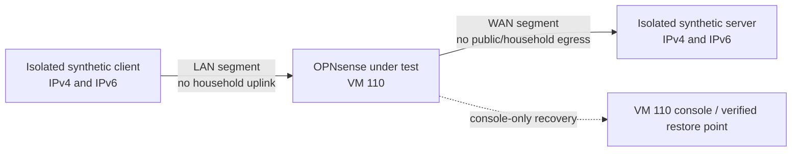

# Isolated packet lab design

**Task:** [M00-W03-T01](../tasks/m00/M00-W03-T01.md) · [GitHub #7](https://github.com/JoseLArantes/detew/issues/7)\
**State:** design proposal; console entry is available, but isolation and recovery have not been verified\
**Architecture inputs:** ARC-04, ARC-14; ARCH-G01; [packet path](../ARCHITECTURE.md#6-packet-adapter-and-inspection-path), [G0 proof](../ARCHITECTURE.md#63-required-g0-proof), [milestone evidence rules](../MILESTONES.md#52-evidence-artifacts-and-measurement-rules)

This document defines the required shape of a repeatable client/gateway/server lab and records the current candidate environment. It does not authorize changing any network outside Proxmox VM 110. No packet attachment, interface reconfiguration, package installation, or baseline run is considered safe until the isolation and recovery prerequisites below pass.

## Safety boundary

- The only permitted Proxmox scope is the configuration and console of VM 110. Do not change the Proxmox host, host bridges, storage, firewall, permissions, or any other VM. Do not create a host bridge as a shortcut.
- OPNsense VM 110 is the only guest in scope. Treat its current interfaces as connected to the household network until the owner independently confirms otherwise.
- Never generate benchmark or denial traffic on the household network. The current guest interfaces are not client/server lab segments.
- Before any packet-adapter or interface mutation, require a VM 110 console session verified while guest networking is unavailable, a restorable VM 110-only snapshot or equivalent verified restore point, and a written teardown procedure. Console access to the running guest menu is available, but these recovery prerequisites have not been tested.
- Test traffic and names must be synthetic. Capture only the generated flow, use lab addresses, and review/redact captures before retaining or sharing them. No household browsing, credentials, appliance configuration backups, or unrelated payloads belong in evidence.
- If isolation or recovery cannot be proved, stop before attachment or route changes. Retain the failure as a lab blocker; do not substitute a firewall rule on a live uplink for physical/virtual network isolation.

## Observed candidate guest

The following is the reported read-only inspection baseline; it is not a supported target or a validated lab:

| Field | Observed |
|---|---|
| Proxmox scope | VM 110 only; no host or other-VM changes permitted |
| Guest | OPNsense `26.1.2_5-amd64`, FreeBSD `14.3-RELEASE-p8` |
| Guest CPU | QEMU virtual CPU, 1 core / 1 thread |
| Guest interfaces | LAN and WAN are both attached to the same household IPv4 `/24`; exact addresses are omitted |
| Gateway/routing | Household default route reported; exact addresses and route details are omitted |
| Current addressing risk | The guest interfaces share a household subnet; this is not an isolated test topology |
| Guest management | HTTP web administration was reachable; HTTPS and SSH were not reachable during the inspection |
| Recovery access | Proxmox UI opens the VM 110 console and displays the OPNsense menu. Authentication, access with guest networking disabled, snapshot restore, and detach recovery are not verified. |
| Project target | OPNsense CE 26.7 series / FreeBSD 15.1 amd64, as documented in ARCHITECTURE; current guest differs |

Do not infer that an interface address or “WAN” label proves its actual upstream isolation. These observations are not an authorization to disconnect or readdress either interface.

## Required target topology

The target uses two isolated layer-2 segments and three roles. The only router under test is OPNsense in VM 110. Client and server endpoints must be synthetic and must not be production clients. Both segments must terminate inside a verified isolated environment with no path to the household uplink or public Internet. They must not be implemented by adding a Proxmox host bridge.

No such client/server path is currently verified. Before provisioning, the operator must identify a permitted way to supply both isolated segments using VM 110 only. Acceptable candidates require explicit inspection and proof before use:

1. A pre-existing isolated virtual network, if one exists, with VM-110-only virtual NIC changes and separately available synthetic endpoints. Its bridge must already have no physical uplink; do not create or modify Proxmox host networking.
2. A guest-local virtual topology inside OPNsense, only if its VNET/epair or equivalent interfaces are supported by the exact guest build and selected packet adapter. Before using it for packet tests, VM 110's external vNICs must be disconnected at the VM boundary or another independent upstream barrier must prove no egress; guest pf/route rules alone are insufficient. First verify the independent console, then prove the guest-local topology exercises the relevant firewall and adapter path. Treat it as a virtual candidate, not evidence for a physical NIC or general support.

If neither candidate can meet the isolation boundary, the lab is not provisionable under the current scope. Record the missing isolated path and request a revised authorized environment; do not attach the test to the existing home subnet.

### Address and route plan

These are reserved test-only examples, not configured addresses. Confirm they do not overlap with the actual lab endpoint routes before use.

| Segment | IPv4 | IPv6 ULA | Roles |
|---|---|---|---|
| Isolated LAN | `198.18.0.0/24` | `fd42:6465:7465:7701::/64` | Client `.2` / `::2`; gateway `.1` / `::1` |
| Isolated server side | `198.19.0.0/24` | `fd42:6465:7465:7702::/64` | Gateway `.1` / `::1`; server `.2` / `::2` |

The VM under test routes only between the two lab segments. The base fixture has no default route from either synthetic endpoint and no gateway route from the isolated network to `vtnet0`/`vtnet1`. The VM's external vNICs must be disconnected or bounded by a separately verified upstream isolation barrier during packet tests. Packet filtering on the guest is an additional control, not the isolation boundary. If a test requires NAT, enable it only between the two isolated segments, record the pre-NAT and post-NAT observations, and prove the client address stage seen by the adapter. Any need for DNS uses a local synthetic resolver or fixed fixture addresses; no public resolver is required.

### VLAN, NAT, and unsupported variants

The base topology is untagged routed IPv4/IPv6. Add separate variants only after the base is recovered and repeatable:

| Variant | Fixture | Evidence to record |
|---|---|---|
| VLAN | Tagged client/server fixture VLANs (proposed IDs 101 and 102) carried only by the isolated virtual link | Tag presence at client, gateway ingress/egress and server; filtering order; any dropped/untagged frame behavior |
| NAT | Translation between the isolated LAN and isolated server-side segments | Original client before translation, translated address/port, reply path, connection state and packet captures at both endpoints |
| IPv6 | Routed ULA on both isolated segments, with explicit IPv6 policy | Neighbor discovery, both traffic directions, firewall allow/deny, and no dependence on IPv4 NAT |
| Long-lived | TCP established before a policy/adapter action, plus sustained TCP and UDP flows | Direction, flow age, continuity/termination, counters and client/server delivery |
| Virtual NIC candidates | Exact guest-visible NIC model and driver; candidate is not presumed supported | Link/MTU/offload/queue settings, capture ownership, bidirectional visibility, reinjection and failure behavior |
| Unsupported until measured | Physical NICs, hardware VLAN offload combinations, multiple WANs, bridges to any production LAN, public egress, and any unlisted topology | Mark unsupported/unmeasured; do not generalize a virtual test result |

## Provisioning and pre-attachment checklist

Use this order for a future lab run. Record the owner, independent reviewer, task reservation and intended restore point before beginning.

1. **Inventory without mutation.** Record VM 110 identity, guest release/kernel, configured virtual NIC models and mappings, topology, addresses, routes, DNS, pf state/rules and active client impact. Record Proxmox version and relevant VM-only hardware fields if access permits. Do not export or publish credentials, secrets or unredacted appliance configuration.
2. **Establish recovery.** Open a VM 110 console that remains available after all guest networking is disabled. The current evidence only establishes that the Proxmox UI can open the running guest menu. Confirm local authentication without relying on the web UI, SSH, LAN or Detew. Create a restorable checkpoint of VM 110 and verify which operator can restore it. Conduct a tabletop blackhole/remote-administration-loss drill; the reviewer must point to the console restore/detach path without using Detew. Then exercise recovery on the isolated guest before any adapter attachment.
3. **Prove isolation.** Identify the exact LAN and server-side L2 segments and all physical/virtual uplinks. Inspect routes and forwarding. Place VM 110's external vNICs behind a verified no-egress boundary or disconnect them at the VM boundary. From both synthetic endpoints, attempt IPv4 and IPv6 access to an explicitly controlled sink on the isolated side and verify there is no route/path to household or public destinations. Observe on the external boundary as well as endpoint output. If any path is uncertain or succeeds, stop and tear down the fixture.
4. **Provision base path.** Use only the approved isolated endpoints/VM-110-only NIC settings or the proven guest-local alternative. Configure the address plan, explicit routes, pf permit/deny fixtures and traffic sinks. Verify ordinary client-to-server traffic and server-to-client replies in bypass mode, with simultaneous captures at both endpoints and gateway interfaces.
5. **Record exact inputs.** Fill the run manifest below for every installed version and setting. Pin the exact OPNsense image/package revision, FreeBSD kernel, virtual NIC model/driver, VM CPU/RAM, firmware/machine type, MTU/offloads/queues, pf rules, adapter build, compiler, capture and generator tool versions, test fixtures and source digests. “Latest” or an unrecorded default is not an input identity.
6. **Validate safety behavior.** Verify an explicit pf deny by observing that the server receives no corresponding synthetic packet, while a permitted fixture succeeds. Confirm both directions and original-client address stage. Test existing/long-lived flows and capture-consumer conflicts. No Detew adapter is attached in the initial bypass baseline.
7. **Teardown and restore.** Stop generators, preserve only approved synthetic evidence, remove test-owned guest endpoints/rules/routes/NAT/VLAN state, then compare the VM 110 guest configuration against the recorded pre-run inventory. If recovery is uncertain or the guest is unhealthy, restore only the VM 110 checkpoint through the verified console/operator path. Verify management and ordinary connectivity after restore; record any mismatch. Never restore or edit the Proxmox host as part of guest teardown.

Do not move to step 5 or attach an adapter until steps 1–4 have evidence and independent review. In particular, step 2 is a hard gate.

## Traffic and bypass baseline method

The bypass run measures the candidate topology and normal forwarding path; it is not an inspection result or filtering claim. Use the same guest build, CPU/RAM, NIC/MTU/offloads, pf fixture and endpoint workload for all later adapter comparisons. Do not set numerical pass targets here; the PRD and G0 review own supported performance thresholds.

- Capture at the synthetic client, each guest-side gateway interface and synthetic server using bounded ring files. Use generated HTTP/TLS/UDP fixture traffic with no personal data. Record capture-drop counters and synchronize timestamps.
- Run TCP and UDP throughput, RTT/latency, packet loss and connection-establishment workloads. Include payload sizes 64, 512 and 1,400 bytes where supported; record exact tool arguments and the offered UDP rate. Include one-flow and multi-flow runs and both traffic directions.
- Use at least five repetitions per fixed workload after the same warm-up period. Retain each result; report median, minimum/maximum and variability. Record CPU, memory, interface/driver counters and the exact runtime duration. Separate steady-state goodput from saturation/loss behavior.
- Run a permitted-flow fixture and an explicit pf-denied fixture. Expected: the permitted flow reaches the server and its reply reaches the client; the denied flow is absent at the server capture. A firewall log alone does not establish absence or delivery.
- Record the client address at client capture, gateway ingress, gateway egress and server capture. For NAT, preserve both original and translated tuple mappings. For each packet capture, record interface/direction and whether timestamps and checksum/offload handling affect interpretation.
- The report must state unmeasured hardware, traffic classes, interfaces and topology variants. A bypass number is a reference for this environment only, not a product capacity promise.

## Run manifest

Copy this table into each future `EV-M00-W03-T02` or adapter report and replace every blank with a value or explicit `unavailable`/`not applicable` reason.

| Input | Recorded value |
|---|---|
| Git commit / dirty-tree digest | |
| OPNsense image, package revision, FreeBSD kernel | |
| Proxmox version; VM 110 firmware/machine type/CPU/RAM | |
| vNIC model, driver, guest interface, link mapping, queues/offloads | |
| Lab segment IDs, isolation boundary, IPv4/IPv6 prefixes and routes | |
| VLAN IDs, NAT/pf fixture and rule digest | |
| Packet adapter/candidate build, native dependencies and compiler | |
| Traffic generator, capture tools, versions and exact commands | |
| Fixture identities/licensing and SHA-256 digests | |
| MTU, duration, warm-up, repetitions and offered rate | |
| Capture points, direction, timestamps, drops and redactions | |
| Observed outcome, expected outcome, limits and anomalies | |
| Recovery checkpoint identity and console test evidence | |
| Reviewer, review date and teardown verification | |

Store private operational details outside public reports. Public reports may retain synthetic lab addresses and non-sensitive version/measurement identities, but must omit household addressing, credentials, session material, real client identifiers and unrelated payloads.

## Current gate and next action

The existing guest does not meet the lab entry criteria. Its LAN and WAN are on the same household subnet; a separate dual-stack synthetic client/server path is not verified; only console entry to the running guest menu is verified; authentication with guest networking disabled and restore/detach recovery remain unverified; and its OPNsense/FreeBSD versions differ from the architecture target. No interface, route, pf, package, host network, or VM configuration has been changed for this plan.

Before M00-W03-T02 can begin, the maintainer/operator must provide or verify a VM-110-only isolated segment/endpoints and an independent console plus restore method. Then the lab owner must run and review the isolation/console checks above. Until then, topology variants, throughput, RTT, pf outcomes, adapter compatibility and recovery are **unmeasured**.
