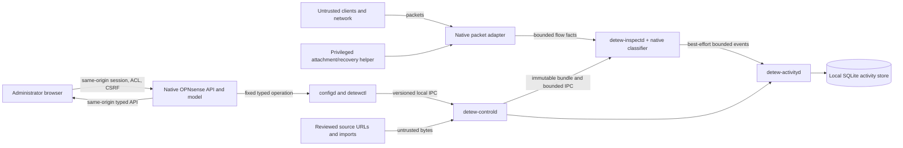

# Detew V1 threat model and privilege inventory

**Status:** M00 design review; proposed controls only until implemented and tested\
**Owner:** JoseLArantes, project maintainer\
**Task:** [M00-W05-T01](../tasks/m00/M00-W05-T01.md) · [GitHub #11](https://github.com/JoseLArantes/detew/issues/11)\
**Requirements:** SEC-01–04, PRI-01, PRI-03\
**Architecture decisions:** ARC-01–03, ARC-06–12, ARC-14–15; packet/classifier gates ARCH-G01/02

This document describes the intended V1 design from [PRODUCT](../PRODUCT.md), [ARCHITECTURE](../ARCHITECTURE.md), and [CONTEXT](../CONTEXT.md). It is not an audit of an implementation. The services, account permissions, socket protocols, host actions, and mitigations below remain proposals until their owning implementation tasks supply evidence. V1 does not protect a compromised OPNsense kernel or an actor who already controls appliance root.

## Security goals and assumptions

The design aims to preserve the host firewall and management path; prevent an unauthenticated client from changing desired or active policy; keep policy and packet work bounded; limit host privileges to fixed operations; preserve the integrity and provenance of policy bundles and category data; and keep decision metadata local unless an administrator deliberately exports it. A failed control, reporting, or update service must not silently change the inspection engine's active policy. A missing enforcement observation must not be presented as a confirmed block or a healthy protection state.

The trusted computing base is the OPNsense kernel and native firewall, native administrator/session/ACL/CSRF mechanisms, installed Detew binaries and package metadata, the narrowly defined privileged attachment/recovery action, and the local filesystem permissions that protect their state. The browser, LAN clients, packets, imported configuration, downloaded sources, event messages, third-party dependencies, and future extension inputs are untrusted. A valid administrator can still choose an unsafe policy; preview, expected-revision checks, explicit apply, recovery instructions, and audit metadata reduce accidental harm but do not make an authorized choice harmless.

The design is for one local appliance/site in V1. Optional managed TLS inspection is deferred to T1 and is outside this threat model's implemented scope. The proposed architecture does not use Kubernetes on the appliance and does not require a general-purpose module loader.

## Assets and security impact

| Asset | Required property | Impact if lost or exposed |
|---|---|---|
| Native desired configuration and administrator identity | Only authorized native actions can change them; native XML remains the sole desired-state authority (ARC-08). | Unauthorized policy changes, management lockout, or divergence between displayed and intended policy. |
| Active immutable bundle and activation journal | Integrity, compatibility, and coherent generation identity (ARC-06/07). | Incorrect or inconsistent decisions, unsafe rollback, or false applied status. |
| Packet path, attachment ownership, and recovery route | Preserve native pf behavior; attachment/detachment is bounded, owned, and recoverable (ARC-04/14). | Traffic disruption, an unnoticed inspection bypass, or loss of appliance management access. |
| Category data and classifier/catalog inputs | Provenance, exact identity, eligibility, integrity, and admitted rights. | Poisoned classifications, missing required categories, unsafe parser input, or unlawful redistribution. |
| Local decision metadata and configuration history | Least collection, bounded retention, access control, redaction, and deletion. | Disclosure of household or organizational activity, hostnames, device associations, or administrator actions. |
| Local secrets, session material, package/signing material | Do not expose to UI assets, logs, unprivileged peers, or ordinary exports. | Impersonation, unauthorized update, or broader appliance compromise. |
| Runtime resources and service availability | Bound packet parsing, queues, downloads, memory, disk, and control operations. | Engine overload, logging/storage failure, denial of service, or a misleading coverage claim. |

## Trust boundaries

The boundaries follow ARC-03 and ARC-09. The diagram is logical: process boundaries, credentials, file ownership, and host actions still need implementation evidence. The native classifier shim is within the inspection engine in the current architecture; it is not a separate crash-isolation process.

| Boundary | Attacker-controlled input or action | Intended authorization, validation, and bound | Required evidence |
|---|---|---|---|
| TB-01: network to packet adapter/parser | Malformed, fragmented, reordered, oversized, or high-rate packets; crafted protocol fields; connection churn. | Adapter-specific ownership checks; bounded packet, flow, reassembly, parser, and classifier state; no borrowed ring memory retained; explicit limit and failure outcomes. No remote input directly selects a privileged host action. | Exact FreeBSD/NIC/topology packet tests; fuzz/sanitizer results; IPv4/IPv6, pf order, overload, engine death, and recovery evidence (M02, ARCH-G01/02). |
| TB-02: browser to native host API | Forged requests, CSRF, stale revision, viewer mutation, HTML/script injection, oversized or unknown fields. | Native OPNsense session, ACL, and CSRF checks on every mutating method; server-side schema/semantic validation; expected-revision enforcement; output escaping; bounded request size. The frontend is not an authority. | Native controller tests for admin/viewer, session expiry, CSRF/method violations, oversized values, stale revisions, and host-shell integration (M04). |
| TB-03: host/configd/command bridge to control service | Crafted identifiers, command arguments, replayed operations, false actor claims, malformed frames, or stale endpoints. | Fixed allow-listed host actions; typed IDs and envelopes; no shell interpolation or arbitrary path/command API; bounded framed IPC; local peer credential verification; operation IDs and revision checks; reject invalid or missing credentials. | FreeBSD credential/socket tests for invalid UIDs, replacement/stale sockets, truncated/oversized frames, replay, and authorization at each action (M04/M09). |
| TB-04: control service to inspection engine | Corrupt or incompatible bundles, replayed commit, wrong generation, untrusted file reference, or oversized control frame. | Control service validates and prepares immutable artifacts; engine checks manifest, schema/capability versions, and content identity before load; bounded local IPC; one coherent bundle/context per decision; workers acknowledge generation changes. | Corruption, compatibility, interrupted activation, worker-stall, replay, and partial-generation tests (M05/M07/M09). |
| TB-05: category source/import to control/compiler | Malicious URL/redirect, DNS rebinding, archive/decompression bomb, hostile JSON/CSV, path traversal, poisoned entries, or misleading license metadata. | Source admission precedes use; TLS validation and explicit redirect/egress rules; archive/file/count/length quotas; schema and semantic validation; path-safe staging; provenance/digest/license manifest; quarantine until a validated immutable candidate exists. Downloads never occur in the packet path. | Malicious archives/import fixtures, redirect/egress tests, missing-rights rejection, poisoning review, and resource-bound measurements (M03/M07/M09). |
| TB-06: native classifier FFI within inspection process | Malformed packet-derived lengths, invalid pointers/state, classifier bug, native allocation exhaustion, or memory-safety defect. | Narrow shim validates lengths and lifetime/ownership; explicit error codes; no Rust unwind across C; native allocations are measured and bounded where the library permits. The same-process shim does not contain a native crash. | Host-native sanitizer/fuzz/lifetime evidence and exact process/failure behavior (M02-W03/M02-W02, ARCH-G02). A separate process boundary requires a new architecture decision and evidence. |
| TB-07: inspection/control to activity service and store | Forged event, replay/duplicate, flood, SQL-shaped text, path-like fields, malicious query/export request, or store exhaustion. | Separate unprivileged activity account and store ownership; bounded nonblocking event envelope; peer credentials and versioned schema; parameterized queries; quotas/retention; dropped-event counters; no decision waits for persistence. Activity service has no policy-authority or host-helper capability. | Cross-account filesystem/socket tests, malformed/flood/replay inputs, SQL query tests, disk-full behavior, and loss-interval evidence (M05/M08/M09). |
| TB-08: package/build/update supply chain | Compromised dependency, build script, release artifact, source archive, or update transport; license/source substitution. | Exact locks and artifact digests; dependency/data admission; signed release/checksum verification; SBOM/notices; least-privilege build and update operations; quarantine and rollback of an invalid candidate. | Reproducible build, signature/SBOM/notice verification, dependency audit, update substitution and rollback tests (M00/M09/M11). |
| TB-09: local files, sockets, and trusted host boundary | Local unprivileged process attempts socket replacement, symlink/path substitution, secret read, or state modification; root/kernel compromise bypasses all local controls. | Dedicated accounts; restrictive ownership/modes; safe directory and atomic-file handling; peer credential checks. Root/kernel compromise is explicitly outside the protection boundary. | FreeBSD package permission and socket replacement tests; recovery and tamper assumptions documented. |
| TB-10: diagnostic/export/correction workflow | Sensitive hostnames, device names, addresses, activity, credentials, or packet payloads included in an export or correction submission. | Default local-only metadata; no automatic telemetry, cloud categorization, crash upload, packet/body retention, or contribution submission; redaction/content/size/destination preview before deliberate export; secret and activity data separated. | Inspect generated bundles/fixtures/logs with synthetic markers; verify no send path is triggered by preparation; test retention/deletion (M08/M09). |

## Process, store, socket, and elevated-action inventory

This inventory maps the selected architecture to the minimum intended authority. Final Unix account names and exact filesystem paths belong in package metadata and must be reviewed against these roles. “Proposed” below does not mean the boundary exists in a running system.

| Component/account intent | Owns or may access | Must not access or do | Authentication/authorization boundary | Decision and evidence owner |
|---|---|---|---|---|
| Native OPNsense frontend/API; existing host web account | Host session, role/ACL checks, same-origin UI/API, native desired-model writes. | Arbitrary shell execution; alternate policy store; accepting frontend-only validation as authority. | Native host authentication, ACL, CSRF, protected methods; check each mutation. | ARC-08/09/11/12; M04-W02/W03. |
| `detew-controld`; dedicated unprivileged account | Validate/compile/activate requests, versioned operation history, reviewed data jobs, status, immutable candidate bundles/journal. | Direct XML writes; packet-by-packet decisions; SQL ownership; arbitrary root/helper commands; unbounded source content. | Versioned Unix socket, peer credentials, typed methods/revisions, filesystem ownership. | ARC-03/06/07/08/09; M04/M05/M07. |
| `detew-inspectd`; dedicated inspection account after validated attachment | Flow/worker state, local classifier/indexes, active bundle snapshot, policy decision and adapter actions allowed by its attachment model. | Root by default; configuration XML, activity DB, downloaded data, UI/authentication, arbitrary host changes. | Adapter attachment/descriptor boundary; validated local control channel; input bounds. | ARC-02/03/04/05/06/07; M02/M05/M09. |
| `detew-activityd`; dedicated unprivileged account | Bounded decision-event intake, SQLite database, retention/search/export, its own files. | Packet path, policy decisions, desired config, bundle writes, privileged helper, broad filesystem access. | Restricted event/query sockets, peer credentials, fixed schemas, local role-gated API. | ARC-03/09/10; M05/M08/M09. |
| `configd` + `detewctl`; native action identity | Invoke named, typed Detew operations and diagnostics from the native host. | Generic command forwarding, shell interpolation, caller-selected path, forged actor elevation, policy authority. | Native authorization before fixed action; bounded envelope; allow-list and argument validation. | ARC-09/14; M04-W02; SEC-01/03. |
| Attachment/recovery helper; minimal privileged host action | Open/attach/detach only the adapter resources required; restore only explicitly owned artifacts; narrowly defined diagnostics. | Long-running policy evaluation, category/download processing, arbitrary pf/config edits, arbitrary file writes or commands. | Fixed operation IDs and typed scope; authenticated local caller; explicit ownership; reversible action; console recovery for adapter limits. | ARC-04/14; SEC-01; ARCH-G01; M02-W01/W02 and M00-W03. |
| Approved-source job within control service | Fetch and stage reviewed source content, then hand bounded candidate data to compiler. | Runtime packet lookup, undeclared egress, loading a source solely because it is downloadable, changing active bundle before validation. | Egress/redirect policy, exact source identity, limits, provenance/rights manifest, explicit candidate validation. | ARC-07; M03/M07; OSS-02. |
| Future extension/provider | Declared data or classification capability through a versioned boundary. | V1 packet-loop execution, arbitrary host privilege, undeclared network access or data export. | Explicit compatibility, permission, resource, provenance, and lifecycle contract; run outside packet loop by default. | ARC-15; M13 scope decision. |

| Store/channel | Intended owner and contents | Boundary requirement |
|---|---|---|
| Native `config.xml` / native desired model | OPNsense native model; desired Detew configuration. | Only native-authorized model/controller writes; daemons consume snapshots and never become a competing authority (ARC-08). |
| Immutable bundles and activation journal | Control service; validated configuration/data/capability identities and transition history. | Separate from desired XML and SQLite; integrity/compatibility checked before loading; candidate/active/verified states remain distinct. |
| Activity SQLite database | Activity service only; bounded decision metadata, not packet payloads. | Account-private; retention, quotas, deletion, backup/export policy explicit; no access from packet workers. |
| Local Unix sockets | Owning service or a dedicated restricted runtime directory. | Directory and socket ownership/modes; peer credentials; versioned bounded framing; no LAN listener; reject stale/replaced endpoints and invalid peers. |
| Static UI assets | Native web root, read-only packaged build output. | Same-origin host session/CSRF model; no secrets embedded in bundle; no external CDN/font requests or hosted account dependency. |
| Package/signing/update keys | Host-supported protected location / release process. | Never available to UI or ordinary diagnostics; trust/rotation/rollback procedures are separate release obligations. |

The privileged operation set is limited to adapter-specific **attach**, **detach**, **restore owned attachment state**, and **read-only console diagnostics**. Exact host resource names and operations are gated by adapter evidence. Any request to add an operation must identify its caller, typed inputs, filesystem/network/kernel objects, failure/rollback behavior, and tests. No frontend value may name a command, arbitrary path, interface hook, or configuration file for privileged execution.

## Abuse paths and expected controls

| ID | Abuse path | Intended decision/control | Residual risk and review owner |
|---|---|---|---|
| TM-01 | A LAN client sends a fragmented packet sequence intended to overflow reassembly or exhaust per-flow state. | Parser and queue bounds reject/expire work without unbounded allocation; record limit outcome; preserve selected failure action; never infer successful blocking from a parser error. | Exact packet-path bounds, active-flow behavior, and adapter failure action remain unmeasured; packet/runtime owner and security reviewer at M02/M09. |
| TM-02 | A source serves a compressed archive with huge expansion, traversal names, misleading rights, or poisoned domains. | Admission checks rights before baseline use; decompression/count/size/path limits; schema validation and provenance; quarantine; active dataset remains unchanged until candidate validation. | Redirect/egress, data quality, and lawful redistribution require M03 evidence; data maintainer and security reviewer. |
| TM-03 | An authenticated viewer forges a mutation with CSRF or uses an unknown field to set an internal path/role. | Host ACL/session/CSRF checked on the server for each protected method; reject unknown writes and validate object references/revision; escape reflected fields. | Depends on actual pinned OPNsense controller conventions and integration tests; API owner and host security reviewer at M04. |
| TM-04 | A local process connects to a stale/replaced socket, supplies a root actor claim, or replays an activation request. | Verify kernel peer credentials and caller role from the trusted native boundary; reject claim-only identity; versioned bounded frame; operation ID/idempotency and expected revision; private socket directory. | FreeBSD credential passing and socket replacement behavior unverified; IPC owner at M04/M09. |
| TM-05 | A compromised or malicious extension requests packet-loop execution and root access. | V1 has no generic plugin loader; extensions default outside packet loop and receive only declared capabilities; admission is a maintainer decision (ARC-15). | Future extension API can expand the trusted base and needs its own threat model/review; maintainer at any extension scope decision. |
| TM-06 | A high-rate event flood attempts to stop enforcement or consume the disk through the activity daemon. | Nonblocking bounded queue/event envelope; storage and retention quotas; drop counters and visible completeness gaps; activity account cannot control engine or helper. | Actual bounds, quota behavior, and account isolation need integration testing; activity owner at M08/M09. |
| TM-07 | An attacker crafts bytes to trigger a native classifier memory fault or excessive allocation. | Validate all boundary lengths and lifetimes in the shim; fuzz/sanitize exact build; constrain allocation where feasible; no unwind across FFI. | Classifier is in the same inspection process, so a native crash can stop inspection. A shim is not process isolation. M02 must test the adapter's real failure behavior; if unacceptable, change architecture before production. |
| TM-08 | A vulnerable activity parser/library attempts to rewrite the active bundle or call attachment helper. | Separate unprivileged UID and directory/socket access; database ownership only; no helper/control mutation capability; report service failure without blocking packet decisions. | These denials are architecture intent, not proven package permissions; package/security owner at M09. |
| TM-09 | An export silently includes hostnames, IPs, browsing activity, credentials, or packet capture. | No automatic upload; default redacted metadata; explicit preview for contents/size/destination; secret/activity export separated; fixtures use synthetic markers. | UI/export implementation and retention deletion remain unbuilt; privacy/product owner at M08/M09. |
| TM-10 | Disk-full or process interruption leaves a newer candidate looking active or a false durable success. | Atomic, bounded writes and journal state; active bundle identity separate from desired revision; only worker acknowledgments establish applied; recover to compatible verified state. | Filesystem durability, power-loss and rollback behavior need adversarial integration evidence; control owner at M07/M09. |
| TM-11 | A dependency or release archive is substituted between review, build, and installation. | Exact lock/input identity, digest/signature verification, source/license review, SBOM and release provenance; reject mismatch and preserve known-good artifact. | Signing/build/release chain is not yet implemented; release/security owner at M00/M09/M11. |
| TM-12 | A restrictive failure action blocks the administrator's only management path. | Preflight explains observed adapter behavior; require tested console/out-of-band recovery where no maintained management exemption exists; no broad hidden bypass. | The current household lab has no verified guest console recovery; no host/network enforcement experiments may proceed until the dedicated VM 110 path and recovery are proven. Lab owner at M00-W03/M02. |

## Review boundary and residual risk

The OPNsense host's kernel/root trust boundary is explicit: a privileged host compromise can read local activity and secrets, alter binaries/configuration, or bypass Detew. Filesystem modes, audit records, and a locally stored digest do not make state tamper-proof against root. Protecting against that threat would require a separate externally anchored trust system and is not a V1 claim.

Packet attachment, pf interaction, failure injection, destructive recovery, and teardown experiments are restricted to the isolated lab after console recovery and isolation are verified and a named lab reservation records the intended change and restoration. A live household gateway is not a convenient test target. Until the lab is proven, those experiments remain unrun and unsupported.

The greatest unresolved design risk is native classifier failure inside the inspection daemon. The selected shim narrows and documents the FFI contract, but does not create another process boundary. Before implementation is advertised as safe, M02 must measure memory/lifetime behavior and prove what the packet adapter does after classifier or engine death. If the required action cannot be reliably maintained, record an architecture change or a rejected capability; do not describe the failed process as isolated.

The following reviewers own subsequent evidence: the maintainer owns scope and release decisions; the host/API owner owns OPNsense authentication, CSRF, and configd boundaries; the packet/native owner owns packet, FFI, attachment, and failure tests; the data owner owns source admission and provenance; the activity/UI owner owns collection, export, and retention; an independent security reviewer checks each boundary at M04/M09. The private vulnerability-reporting route is owned by M00-W01-T03, not specified or invented here.

## Source contracts

- [PRD security/privacy requirements](../PRD.md#10-security-privacy-and-open-source-requirements): SEC-01–04, PRI-01 and PRI-03.
- [PRODUCT §9](../PRODUCT.md#9-opnsense-attachment-and-failure-behavior): native firewall relationship, recovery, failure behavior.
- [PRODUCT §13.3](../PRODUCT.md#133-privacy-defaults): local metadata and explicit export.
- [PRODUCT §15](../PRODUCT.md#15-security-and-reliability-design-obligations): security/reliability obligations.
- [ARCHITECTURE §3](../ARCHITECTURE.md#3-deployment-and-trust-boundaries): proposed process/account topology.
- [ARCHITECTURE §11](../ARCHITECTURE.md#11-ipc-and-administrative-apis): local IPC and native API contracts.
- [ARCHITECTURE §14](../ARCHITECTURE.md#14-security-and-operational-visibility): trust, runtime facts, failure isolation.
- [ARC-03/09/15](../ARCHITECTURE.md#1-architecture-decisions): process separation, IPC/API, extension boundary.
